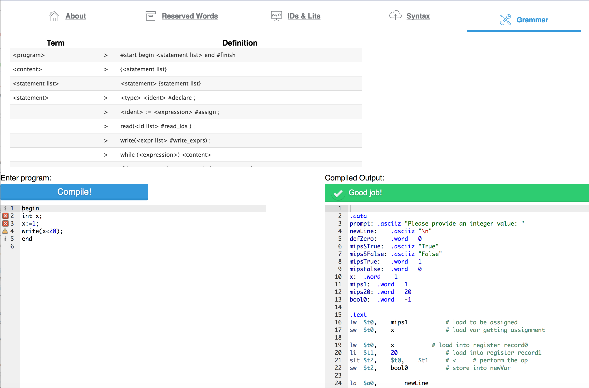

# mips
Compile custom language into MIPS Assembly code through Python.

[](http://www.taylorchasewhite.com/mips/)

This project runs standalone in Python or entirely in a browser at
[the live demo](https://taylorchasewhite.github.io/mips/).

The python code was created in collaboration with Robert Smayda and Miami University as a part of a college course in 2014.

## Browser compiler

The original Python lexer, recursive-descent parser, and code generator run in a
Web Worker using **Pyodide 314.0.8**, loaded from jsDelivr. The four Python modules
are fetched from this repository's static site. Source programs stay in the
browser; no PHP server or source-code upload is needed. The first visit downloads
the Python/WebAssembly runtime and requires an internet connection.

Ace provides the source and read-only assembly editors using its bundled text
mode (the historical syntax modes were missing). Language reference tabs are
collapsed by default. Compile reports diagnostics; Download .asm exports only
the current successful result. Editing source invalidates previous output.
Loading or worker failures are visible and offer Retry compiler.

To preview locally, run `python -m http.server 8000 --bind 127.0.0.1` at the
repository root and open `http://localhost:8000/`; do not open the HTML as a file.

## Command line and execution

With Python 3:

```text
python -B part6/compiler.py part6/test/test.7.1.ml program.asm
```

The CLI returns a nonzero exit code on failure and does not overwrite an existing
output file unless compilation succeeds. Python callers can import
`compile_source(source)` from `part6/compiler.py`; it returns assembly or raises
`ValueError` for invalid programs.

Open the assembly in [MARS 4.5](https://dpetersanderson.github.io/), assemble it,
and run it with **delayed branching disabled** (MARS's default). The website
compiles but does not simulate assembly or prompt for runtime input.

- Programs use `begin ... end`; statements end in semicolons.
- Declarations use `int`, `bool`, or `string`. Assign variables before use.
- `read()` accepts declared **int** variables; `write()` accepts all three types
  and retains the original leading newline per call.
- `if` and `while` conditions must be boolean; comparisons operate on integers.
- Precedence, highest first: unary `-`/`not`, `* / %`, `+ -`, comparisons,
  `and`, then `or`. `!`, `&&`, and `||` are aliases.
- Integer literals are signed 32-bit. Strings support `\n`, `\t`, `\"`, and `\\`.
- Source is limited to 50,000 characters; excessive expression/block depth gives
  an explicit diagnostic. Compilation times out in the browser instead of
  freezing the page.

## Regression tests

```text
python -B -m unittest discover -s part6 -p test.py -v
```

For actual MIPS execution tests, download the official
[MARS jar](https://github.com/dpetersanderson/MARS/releases) and install Java.
Set `MARS_JAR` to its absolute path; optionally set `JAVA` to a Java executable
if it is not on PATH. For example, in PowerShell:

```powershell
$env:MARS_JAR = 'C:\tools\Mars4_5.jar'
python -B -m unittest discover -s part6 -p test.py -v
```

Without `MARS_JAR`, execution tests are explicitly skipped. With it, the suite
checks all 30 historical fixtures (including the two intended type errors),
executes the 28 valid fixtures, and verifies arithmetic, nested/sequential
branches, logical negation, string handling, input, identifier collisions,
diagnostics, and recovery after failed compilation.

## Restoration - November 25, 2026

Repaired with AI assistance while retaining the original authors' compiler.
The old UI called a PHP endpoint that GitHub Pages cannot execute. The restoration
also fixes nested branch labels, boolean negation and aliases, label collisions,
string tokenization, signed integer limits, truncated-input handling, and
success-shaped CLI errors. Historical PHP and generated files remain for
reference but are not used by the website.

GitHub Pages publishes the root of `master`. The
[blog post](https://taylorchasewhite.com/mips/) embeds
`https://taylorchasewhite.github.io/mips/` in an iframe rather than injecting
scripts into WordPress/React. Publish code to `master` and verify Pages before
updating the post's embed and dated repair note.

The older WordPress page at `/projects/mips-compiler/` also embeds the demo.
Keep that page on WordPress's **default template**, not
`compiler-page-widgets.php`: the legacy custom template injects the obsolete
editor and broken iframe independently of the page's saved content.
